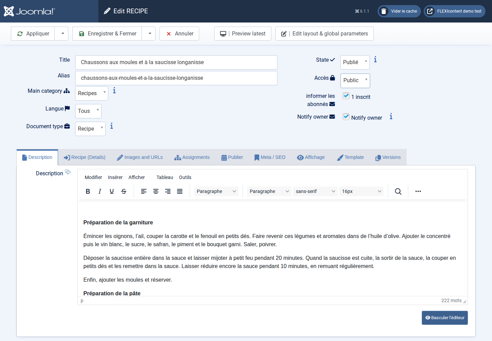
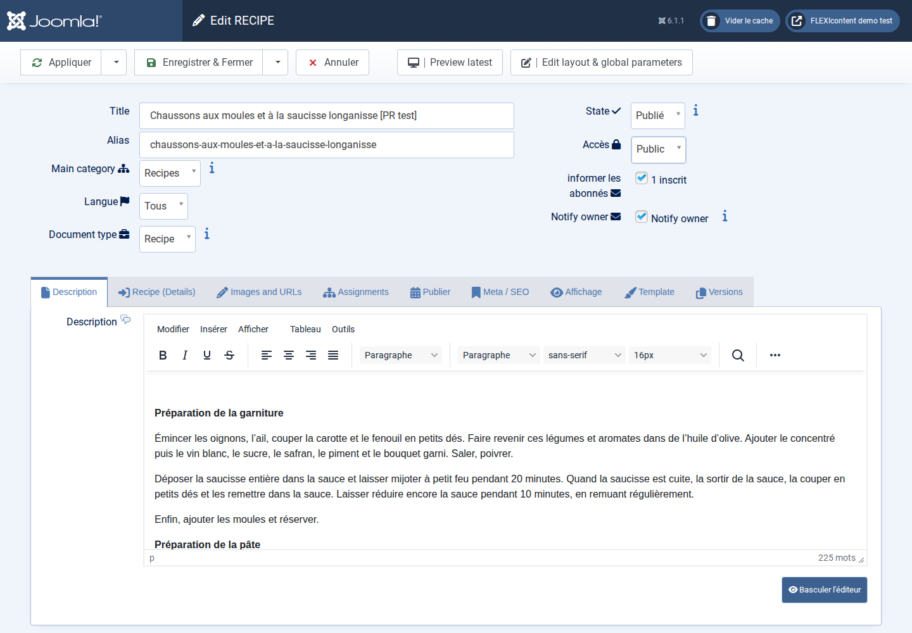
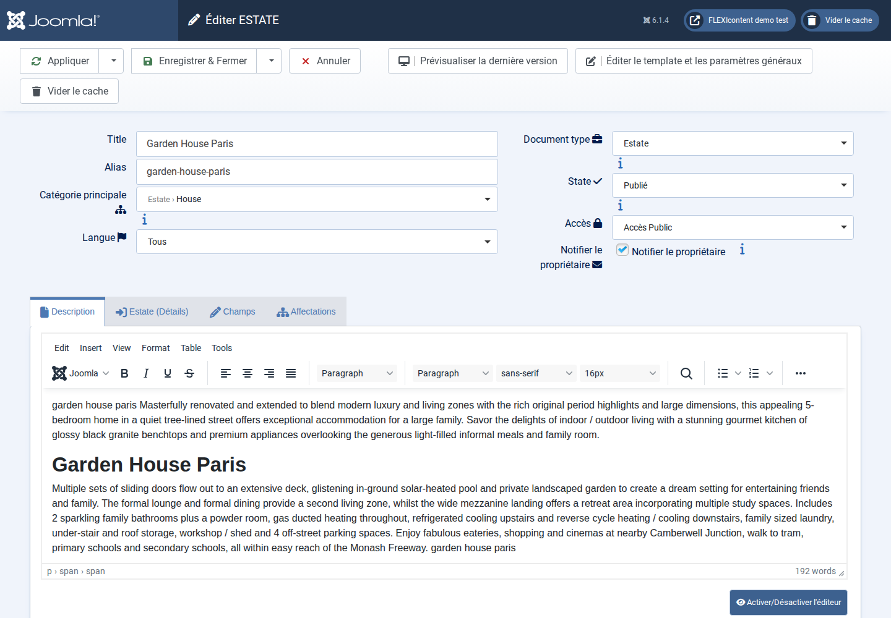
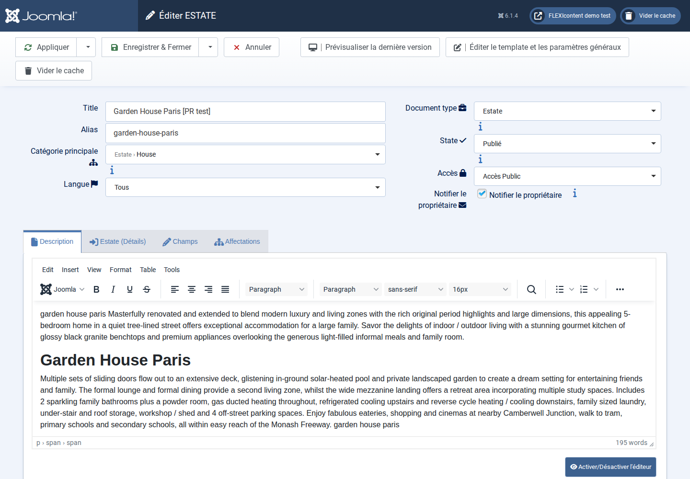

# Native editor workflow evidence

Reviewed upstream: `master`, `66c04c56274e0c00b3a3095be4aa43ffebadd0b3`, FLEXIcontent **5.3**. Candidate: `621bc742bfc5144f255170ec71473e7d1c80119e` (application changes in `c197aec66`).

These screenshots come from disposable offline restores of the public [FLEXIcontent demos](https://flexidemo.com3elles.com/). Before means upstream 5.3; after means the same site with this candidate applied. This comparison isolates the PR from the separate extension upgrade. No changes were deployed to the public demo server.

| Recipe editor before | Recipe editor after |
| --- | --- |
|  |  |

| Real-estate editor before | Real-estate editor after |
| --- | --- |
|  |  |

The recipe archive starts at FLEXIcontent 4.2.1 / Joomla 6.1.1; the real-estate archive starts at FLEXIcontent 5.0.2 / Joomla 6.1.4. Both were upgraded to the pinned 5.3 upstream baseline before applying the candidate. The recipe restore additionally required a fixture-only French locale compatibility repair (`JString::strtolower` to Joomla's `StringHelper`). That repair is not included in this PR.

The screenshot and content-lifecycle run uses candidate `621bc742b`; the subsequent module/import-map correction is commit `3c16b4da94e80566d4cdf200b140d6be41bf09a1` and has separate targeted checks. The final cache-buster-only PHP addition is syntax-checked.

## Shared helper checks

All 22 Chromium helper tests pass: twenty with `window.jQuery` absent and two compatibility cases with actual jQuery/Select2. They exercise required/optional/group validation, hidden editor synchronization, idle upload queues, large-form serialization, cancellation, failure recovery, toolbar POST data, dialogs, ordered script loading, record insertion/removal, actual drag ordering and batch field fetching. The test source and setup are included in the PR under `tests/`.

PHP lint passes for the six changed PHP files. `git diff --check` passes.

## Installed-site workflow results

| Check | Recipe | Real-estate |
| --- | --- | --- |
| Existing item + TinyMCE content saves | Passed, two types | Passed, five types |
| New content validation/creation | Passed | Passed |
| Publish/unpublish/trash/permanent item deletion | Passed | Passed |
| Type, custom field and tag saves | Passed | Passed |
| Batch text-field loading, clear and removal | Passed | Passed |
| Guest cannot open item editing | Passed | Passed |
| Frontend administrator save | Passed | Blocked: editor form did not appear |
| Editor without state permission | Passed: no editable state control | Blocked: editor form did not appear |

The full content runs use `621bc742b`; final targeted runs use `3021f806a`. Both sets include database checks for the stated saves. The real-estate frontend gap prevents calling the whole demo release-ready. The recipe full content run recorded `fcfield_addrint is not defined`; address/map interactions remain unresolved and unverified. Optional `Transition was skipped` exceptions also appeared in earlier full runs. Final targeted runs had no page errors in the monitored administrator page; this is not a claim that every frontend page was error-free.

## Private KitchenSink regression

A separate private Joomla 6.2 restore reproduced four `toggleUploader` exceptions, with no initialized file inputs. The candidate initializes all four uploaders with no uncaught page exceptions. An actual PNG upload and clearing its field value pass. Existing KitchenSink item saving is confirmed against the disposable database. Private before/after screenshots are retained locally rather than published here.

## Limits

- jQuery remains enabled on installed-site tests. The shared-helper suite separately proves the migrated helpers can run without it.
- Field-specific repeaters, conditional form dependencies, Plupload widgets, legacy selector configurations and third-party overrides still depend on jQuery. This is a first migration patch, not authorization to remove the loaders.
- Full field-selection/replacement/permanent-file-deletion coverage, server-persisted batch edits/ordering, all permission combinations and non-Chromium browsers are not certified.
- External maps/services cannot be exercised in the offline fixtures. Any residual console errors are recorded separately from successful workflow assertions.
- The public job-board archive returns HTTP 404. The directory archive has a malformed compressed record with matching downloaded/remote bytes and could not be fully extracted by the JPA parser used here. Neither site is counted as passed.

Final candidate: `3021f806ab716f18357cb03d15a5896e86ebe30b`. The additional validator compatibility/startup change is covered by the same 22-case helper suite.

Runtime SHA-256 values and sanitized workflow results accompany these screenshots. No databases, archives, credentials or site-owned plugins are published.

The real-estate frontend block is reproduced with the correct item URL on both unpatched upstream and the final candidate: both redirect back to login and show "Please Login into an account that can access this page." This leaves frontend save and editor-state controls unverified on that demo; it is not reported as a candidate regression or a pass.

The original recipe batch field that produced the module errors (field 16) was retested with the final candidate: loading and removal pass, and the earlier import/export/import-map exceptions are absent. Its targeted run only recorded the optional "Transition was skipped" exception. The separate native module/import-map test also passes.
