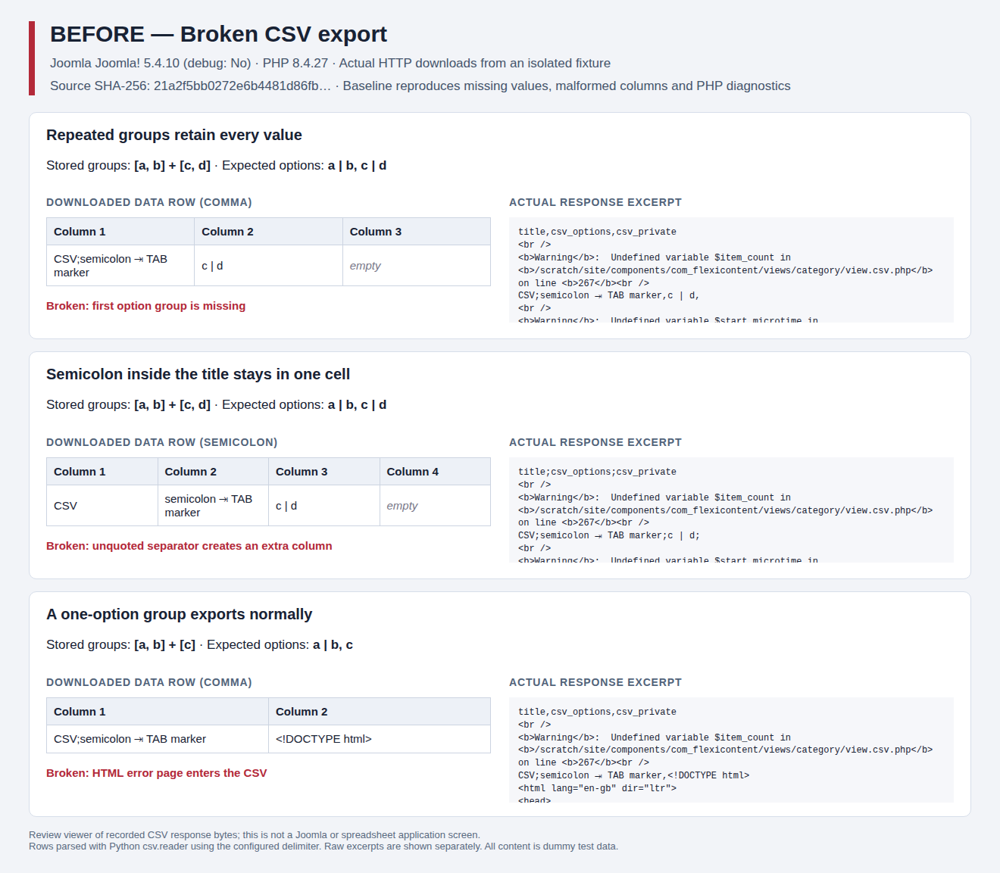
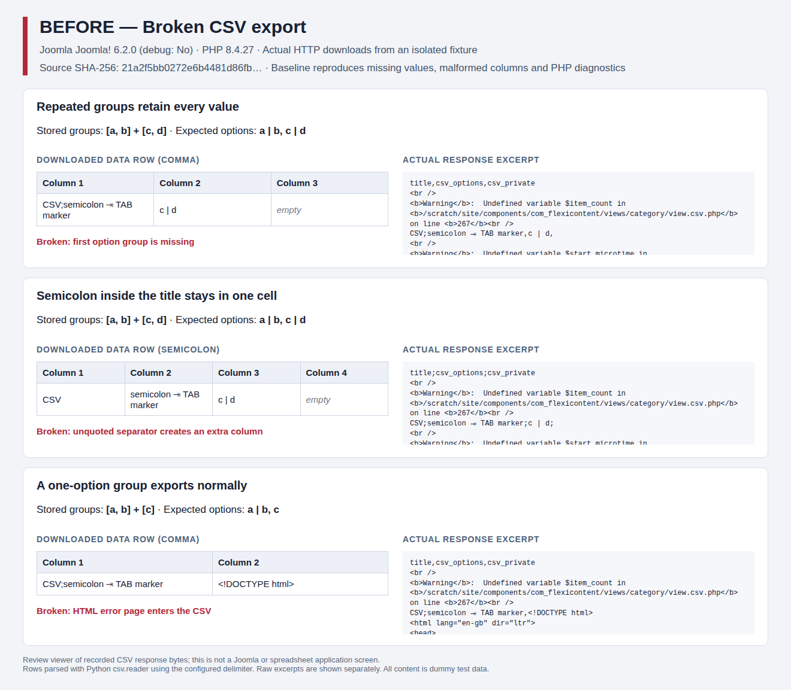
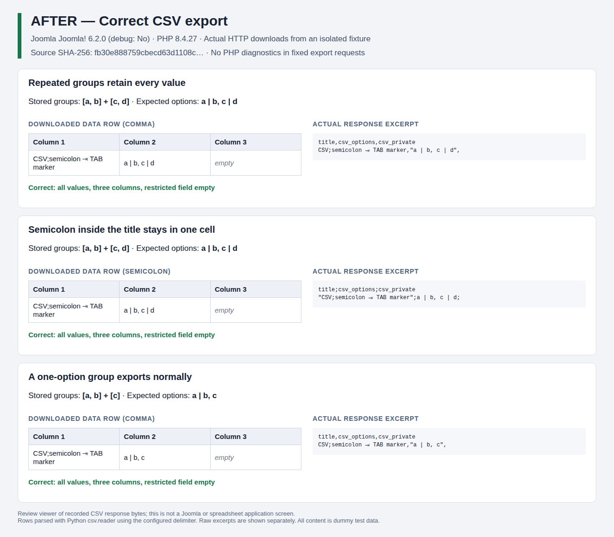

# Category CSV export: before and after

Application commit: [`cde6e608cd84c1908ea4c84b738511f8c1fad229`](https://github.com/iamrobert/flexicontent-cck/commit/cde6e608cd84c1908ea4c84b738511f8c1fad229). Base: `b0f8759c46f9da4ea9c6d51cd4ef08c56a97ba93` (master).

These are browser screenshots of a review viewer built from actual CSV downloads from fresh offline Joomla installations. The viewer displays parsed data rows beside raw response excerpts. It is not a Joomla or spreadsheet application screen. All item content is dummy test data.

| Platform | Before | After |
|---|---|---|
| Joomla 5.4.10 | [](csv-before-j5.png) | [](csv-after-j5.png) |
| Joomla 6.2.0 | [](csv-before-j6.png) | [](csv-after-j6.png) |

The screenshots show three failures and their corrected results:

- `[a,b]` and `[c,d]` previously exported only the last group; both groups now survive.
- `[a,b]` and singleton `[c]` previously inserted an HTML error page into the download; the CSV now contains `a | b, c`.
- A semicolon inside the title previously created an extra column; configured separators are now quoted inside cells.

Undefined-variable warnings also polluted the old downloads. The patch initializes export counters and compares elapsed time in seconds. Fixed CSV requests emitted no PHP diagnostics. The restricted field remains blank in both versions.

## Validation

- **160/160 named checks:** 80 per Joomla version, PHP 8.4.27, MySQL 8.0.46. Counts include installation and expected failing baseline controls, not 160 unique features.
- Six raw-value shapes: repeated groups, singleton last, singleton first, all singletons, zero and empty values. Each uses comma, semicolon and tab, twice before and twice after on each Joomla version.
- Data was saved using normal item forms and checked in the database. The before phase substitutes only the original master CSV view; the after phase restores the exact installed candidate file. Source-file, response and screenshot hashes are in [validation.json](validation.json).
- The standalone shipped-view test passes **72 assertions** on local PHP 8.2.27, 8.3.30 and fixture PHP 8.4.27. It also covers quoted header labels, Unicode, quotes, backslashes, CR/LF and denied field values. It is included in the PHP 8.2–8.4 release-regression CI matrix.
- Two initial stale-cache fixture setup attempts were corrected and excluded from passing counts.

Run the standalone regression from the application checkout:

```sh
php -d error_reporting=-1 tests/category-csv.php
```

For a browser reproduction, enable category CSV export and raw CSV inclusion for a repeatable multiple-select field. Save an item with the group shapes above and a title containing the configured separator. Download `index.php?option=com_flexicontent&view=category&cid=<category>&format=csv`. Compare the downloaded bytes and parsed cells before and after applying the application commit.

The tests used isolated, non-root containers with no external network and fresh dummy databases. The installed BMJ5 site was not modified. This verifies category CSV export; administrator importable/ZIP-media exports and the commercial all-items plugin are outside this focused run. Screenshots and evidence are kept on this separate branch, outside the application PR diff.
