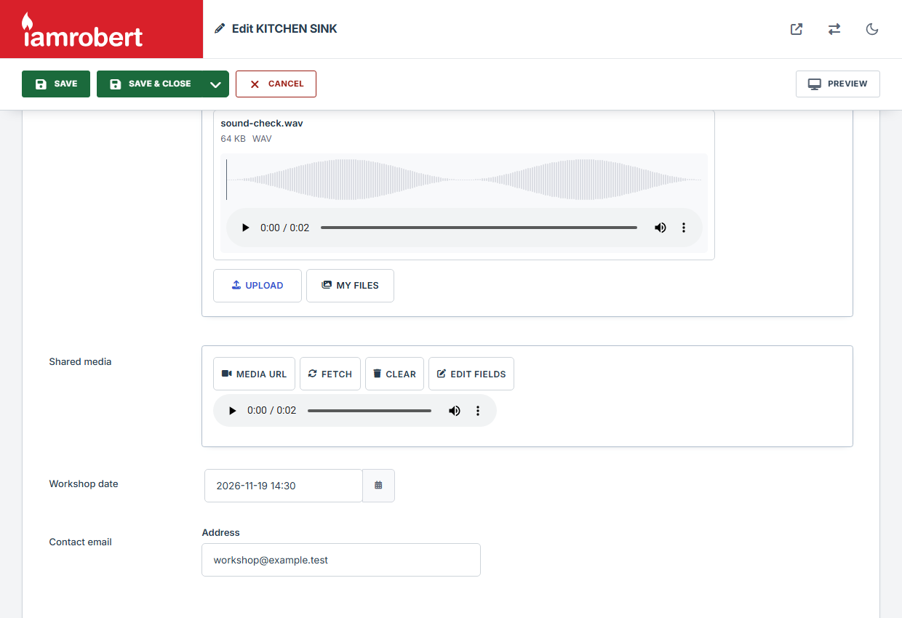
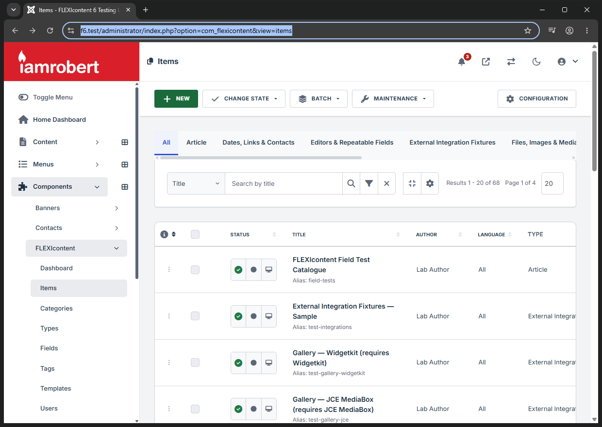

# Before-and-after browser evidence

These screenshots were taken in the signed-in Kitchen Sink editor on the local Joomla 6 test site. The isolated browser loaded the exact before or after JavaScript for each run.

## My Files picker

In **Sample downloads**, open My Files, close it after the transient tooltip node disappears, then scroll down. The old code leaves the editor locked at Sample downloads. The fix releases the lock, and the same 650 px wheel gesture reaches Shared media and Workshop date. The chooser also opens again after the fix.

| Before | After |
| --- | --- |
|  |  |

[Picker browser measurements](picker-actual-run.json)

## Item editor leave warning

The run reproduces late uploader initialization by adding a zero upload count to the open Kitchen Sink editor after it records its initial values. Browser Back runs with the item title and content untouched. The before screenshot includes Chrome's actual **Leave site?** dialog. The patched editor returns to Items without a prompt.

| Before | After |
| --- | --- |
|  |  |

[Leave-warning browser results](leave-actual-run.json) · [Chromium regression results](chromium-evidence.json) · [Firefox regression results](firefox-evidence.json)
