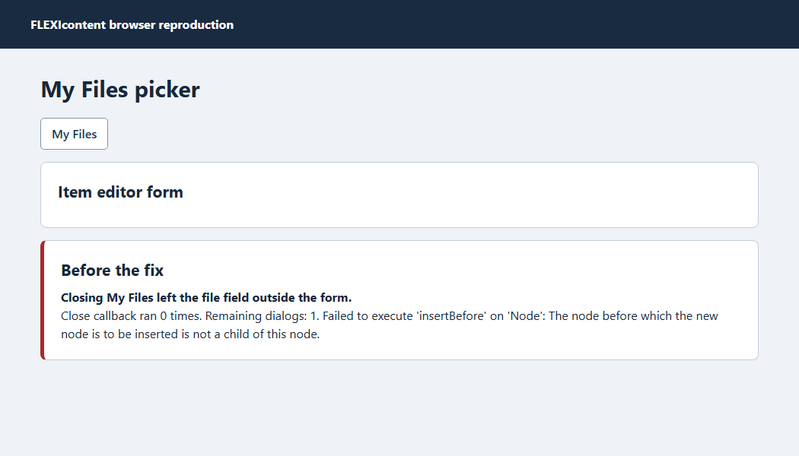
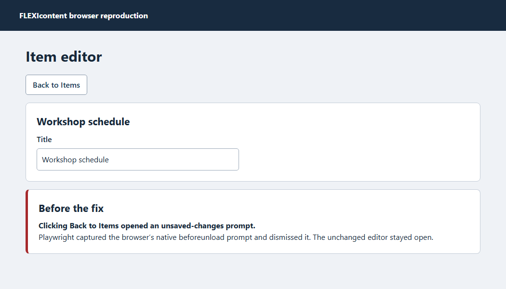

# Before-and-after browser evidence

These captures use isolated pages running the exact FLEXIcontent scripts and Joomla 6 dialog assets. The result panels report what the browsers observed.

## My Files picker

The fixture opens the native Joomla dialog and removes the transient node that stood immediately after the field in the editor. Closing the dialog reproduces the obsolete insertion target at PR #1421 head `4a32e918`. The patched run restores the selected file in the form and invokes the close callback once.

| Before | After |
| --- | --- |
|  |  |

## Item editor leave warning

The fixture opens an untouched item, removes an empty Banner poster input, adds a zero upload count, and clicks Back to Items. Before the fix, Playwright records the browser's native `beforeunload` event and dismisses the prompt. The screenshot shows the editor afterward with the captured result. After the fix, the browser navigates to the list without raising the prompt.

| Before | After |
| --- | --- |
|  |  |

[Chromium results](chromium-evidence.json) · [Firefox results](firefox-evidence.json)
